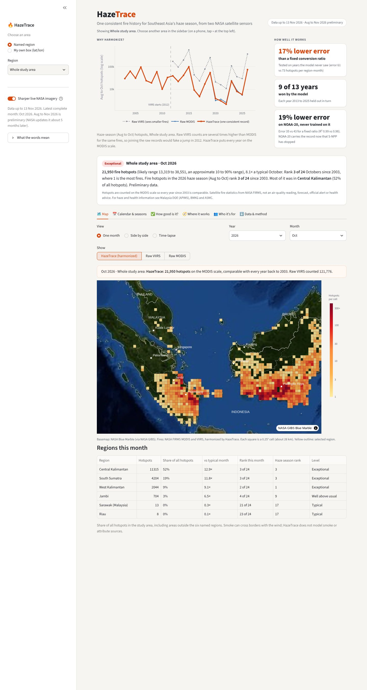
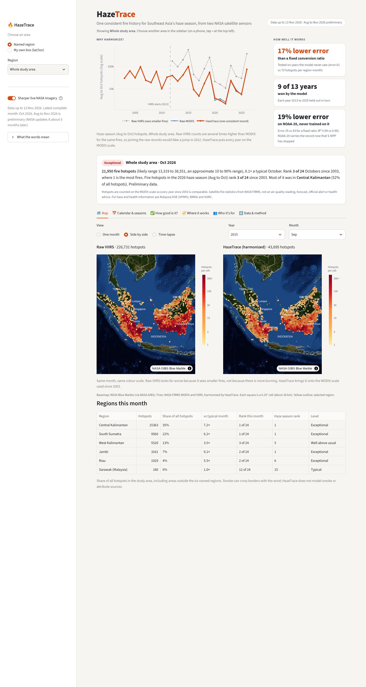
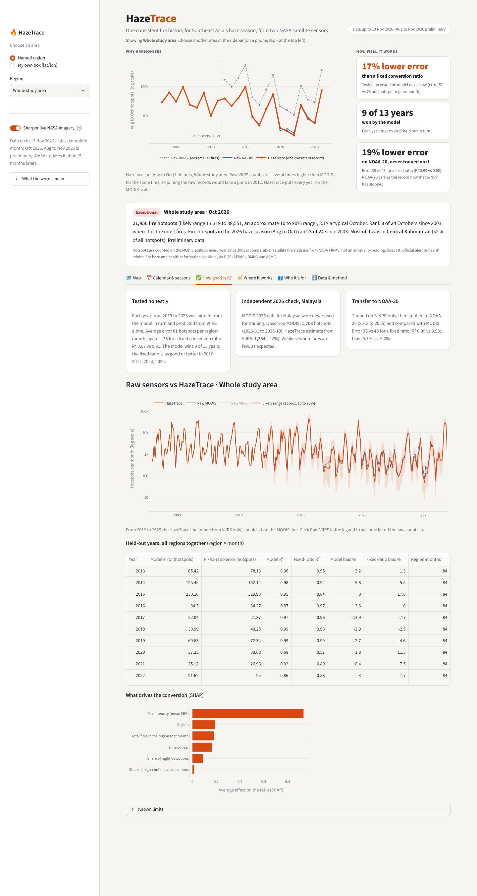

# HazeTrace

**One consistent fire history for Southeast Asia's haze season.**
NASA Space Apps Challenge 2026 · Kuala Lumpur · Team Solo Orbit KL
Challenge: *Harmonization of MODIS and VIIRS Hot Spots*

**Live app:** https://hazetrace.streamlit.app · **Code:** https://github.com/maksudaakhtertumpa/hazetrace · **Licence:** MIT (see `LICENSE`)



| Raw VIIRS vs HazeTrace, September 2015 | How good is it? |
|---|---|
|  |  |

## The problem
Satellites have tracked active fires for over 20 years, but the record is split across sensors.
MODIS (1 km, since 2000) is ending. VIIRS (375 m, since 2012) sees many more, smaller fires, so its
raw counts are several times higher. Suomi NPP VIIRS stopped on 2 Nov 2026; NOAA-20/21 continue.
Mixing raw records creates false trends, so fire managers cannot tell whether this season is unusual.

## What HazeTrace does
1. **Harmonizes** VIIRS detections into MODIS-equivalent counts, so 2003 and 2026 sit on one scale.
2. **Burning calendar:** month × year heatmap for a preset region or a custom lat/lon box.
3. **Anomaly:** a month compared with the same month in every other year (median and rank).
4. **How good is it?** raw vs harmonized series, held-out validation scores, NOAA-20 transfer check, SHAP.
5. **Download:** monthly series and grid-cell data as CSV.

HazeTrace describes past and current fire activity relative to history. **It is not a forecast.**

## Method
- FIRMS hotspots filtered (vegetation fires only; MODIS confidence ≥ 30; VIIRS nominal/high),
  gridded to 0.25° cells per month.
- Paired MODIS and VIIRS S-NPP counts over the 2012–2025 overlap (standard-quality months only; 2026 MODIS
  covers Malaysia only, so it is kept for the independent check).
- **Baseline:** one MODIS/VIIRS ratio per region.
- **Model:** LightGBM Poisson regression of MODIS counts with log(VIIRS count) as an offset, so the
  trees learn only the *ratio* from fire intensity (mean FRP), confidence and night share, season,
  region, land cover and the region's total VIIRS activity that month. Predicting a ratio instead of a
  count avoids the tree models' inability to extrapolate to record years.
- **Finding:** the MODIS/VIIRS ratio is not constant. It is low in big burning seasons (Riau ≈ 0.20 in
  2014–2015) and higher in quiet years (≈ 0.39–0.53 in 2020–2024). The low values are consistent with many
  small, low-intensity fires (often peat) that VIIRS sees but MODIS misses; this is an interpretation, since
  hotspot counts cannot prove the fuel type. A single fixed ratio therefore distorts trends.
- **Validation:** leave-one-year-out at region × month level. The method that wins on held-out years
  builds the final record, automatically and reported as such.
- **Transfer check:** the S-NPP-trained method applied to NOAA-20 (2018+) against MODIS.
- Final record (from Jan 2003, when both Terra and Aqua MODIS fly): MODIS observed before Feb 2012, VIIRS-based MODIS-equivalent after
  (S-NPP to Oct 2026, NOAA-20 from Nov 2026), with an approximate 10–90% band.

## Run it
The repository already contains the results (`outputs/`), so the app runs straight away:
```bash
pip install -r requirements.txt
streamlit run app.py
```
To rebuild everything from NASA data:
```bash
pip install -r requirements.txt
# put every FIRMS CSV (fire_archive_*.csv and fire_nrt_*.csv) under data/raw/
python scripts/01_aggregate.py     # -> data/processed/cell_month.parquet
python scripts/02_harmonize.py     # -> outputs/
streamlit run app.py
```
To test without real data: `python scripts/00_make_fake_data.py` writes FAKE files to
`data/raw/fake/`. **Delete that folder before running on real data.**

Optional: `data/landcover_cells.csv` with columns `cell_lat, cell_lon, landcover`
(e.g. peat / forest / plantation / other) adds the land-cover split to the model and the "Where it works" tab.

## Results (real FIRMS data, held-out years 2013–2025, region × month, province boundaries)
| | MAE (hotspots) | R² |
|---|---|---|
| Baseline regional ratio | 73.3 | 0.914 |
| **LightGBM ratio model** | **60.9** | **0.967** |
| NOAA-20 transfer, baseline | 43.2 | 0.982 |
| **NOAA-20 transfer, model** | **35.2** | **0.990** |

**Independent out-of-time check:** Malaysia 2026 (443 grid cells, Jan–Oct; 2026 MODIS never used in
training): MODIS observed 1,708 hotspots, harmonized 1,334 (−22%). Errors are largest where fires are few.

Both the held-out test and the NOAA-20 test use the same rule as the dashboard: a cell-month with no VIIRS
detection is 0. The model has 17% lower error than the fixed ratio and wins 9 of 13 held-out years,
including the 2015 record year (it loses 2016, 2017, 2024 and 2025). Overall bias +0.8% (fixed ratio +3.7%).
The gain is largest in big burning regions (Central Kalimantan, Riau, South Sumatra). In Jambi, West
Kalimantan and Sarawak the fixed ratio is about as good or slightly better. Weakest: South Sumatra
(R² 0.87, +15% bias). On NOAA-20 the model has lower error than the fixed ratio (35.2 vs 43.2) with a
similar bias (−5.7% vs −5.0%).

## Limitations
- MODIS-equivalent counts are a comparable index, not the true number of fires.
- A cell-month with no VIIRS detection counts as 0 (the same rule is used in validation). In big seasons this
  hardly matters, but in quiet years HazeTrace can be well below what MODIS observed (Riau, Aug–Oct 2021: 57 vs
  298, because 230 of those MODIS hotspots fall in cells where VIIRS saw none). The app shows a warning when
  this happens in the selected area.
- Clouds and haze hide fires from both sensors.
- Recent months are near-real-time (NRT) data, replaced by standard data about 5 months later (labelled
  preliminary in the app and in the `preliminary` column of the CSV).
- Terra MODIS data for 26–27 Mar 2026 removed (flagged questionable by NASA).
- Regions use Natural Earth province boundaries, simplified; cells are assigned by their centre.
- The regional-activity feature was chosen after looking at all years, so the validation is slightly
  optimistic; each held-out year was still never used to fit its own model.
- This build uses FIRMS yearly country files (Indonesia, Malaysia) for 2000–2025, plus a 2026 archive
  download for Indonesia (VIIRS S-NPP, NOAA-20) and Malaysia (MODIS, S-NPP, NOAA-20):
  Jan–Jul standard, Aug–Nov near-real-time. 2026 MODIS for Indonesia is not included, so model
  training and validation stop at Dec 2025.
- NRT files have no `type` flag: detections in 500 m cells flagged as static sources in ≥ 2 earlier
  years are removed (tested on labeled 2026 data: ~2% of real fires lost, net count error ≈ −0.2%).

## Data and citation
- NASA FIRMS active fire data: MODIS Collection 6.1 (MCD14ML) and VIIRS 375 m (S-NPP VNP14IMG,
  NOAA-20 VJ114IMG). NASA Fire Information for Resource Management System,
  https://firms.modaps.eosdis.nasa.gov/
- Map background: NASA Blue Marble imagery via NASA GIBS, https://nasa-gibs.github.io/gibs-api-docs/
  (offline copy cropped from a public-domain NASA Blue Marble world image,
  https://github.com/vasturiano/three-globe).
- Country and province boundaries: Natural Earth 1:10m (public domain), https://www.naturalearthdata.com/
- Software: Python, pandas, LightGBM, SHAP, Shapely, Plotly, Streamlit (open source).

## Use of AI (Super Intelligence)
- **Code:** written with help from Claude (Anthropic), then run, tested and checked by me.
- **Text:** this README, the app text and the submission text were drafted with help from Claude.
- **Data and results:** every number comes from running the code on NASA FIRMS data; no number was
  generated by an AI. The validation results in `outputs/` are reproducible with `scripts/02_harmonize.py`.
- **No AI-generated images, video or audio** are used in the project. The maps and charts are made by the
  code from NASA data.

## App update (14 Nov 2026)

- **Satellite map.** The map now sits on NASA Blue Marble imagery. A bundled image
  (`assets/satellite_sea.jpg`, made by `scripts/fetch_satellite.py` from NASA GIBS, or from a public-domain
  Blue Marble world image when GIBS is unreachable) means the map is never blank offline. With the
  "Sharper live NASA imagery" toggle on, live NASA GIBS tiles load on top when there is internet.
  Country borders (`scripts/make_basemap.py`) and province outlines (`scripts/make_provinces.py`) come from
  Natural Earth (public domain).
- **Raw vs harmonized toggle.** Show HazeTrace, Raw VIIRS or Raw MODIS for any month on one shared colour
  scale, with a plain-language explanation of the difference.
- **Side by side.** Raw VIIRS next to HazeTrace for the same month.
- **Time-lapse.** Haze seasons 2003 to 2026, or the months of one year, for HazeTrace or Raw VIIRS.
- **Real province boundaries.** Regions are now assigned by point-in-polygon against Natural Earth
  provinces (`hazetrace/regions.py`) instead of rectangles. `scripts/02_harmonize.py` was re-run with them:
  see Results above (validation now uses the same zero rule as the dashboard).
- **Light theme** and a new layout: why harmonize, how well it works, summary card, six tabs.
- New dependency: `shapely>=2.0` (`pip install -r requirements.txt`).
